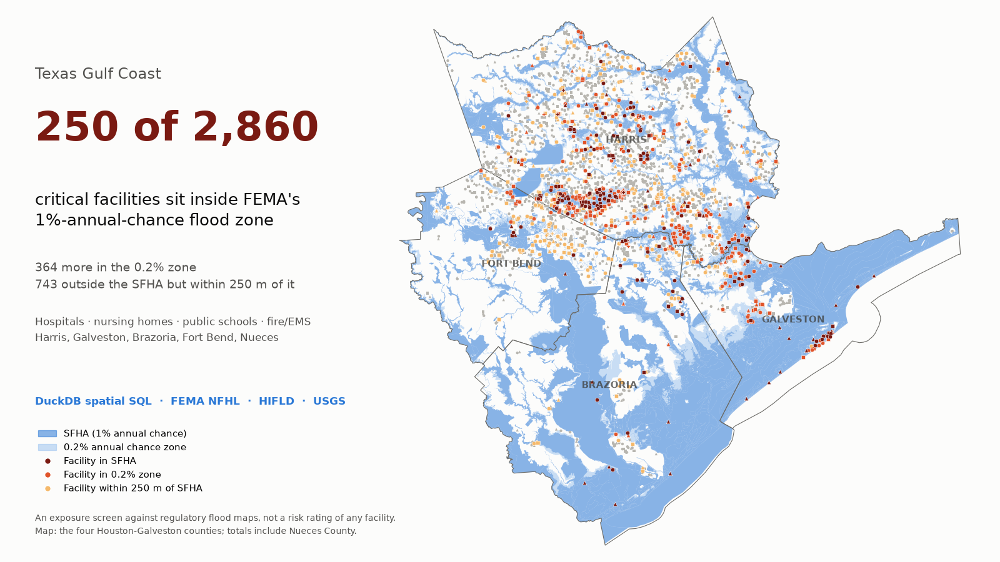
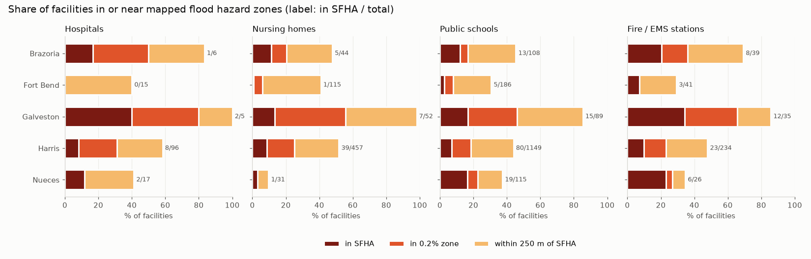
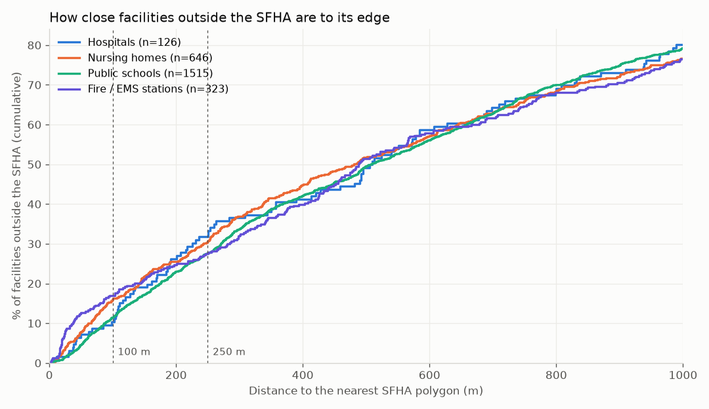
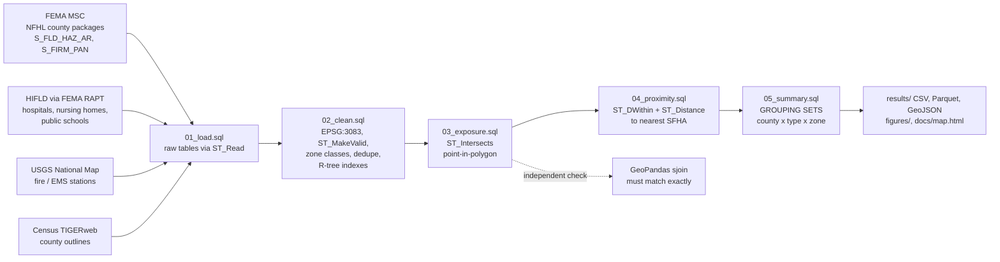

# Critical facilities in mapped flood hazard areas: a spatial-SQL pipeline for the Texas Gulf Coast

**Question.** How many hospitals, nursing homes, public schools and fire/EMS stations in five Texas Gulf Coast counties (Harris, Galveston, Brazoria, Fort Bend, Nueces) sit inside FEMA's mapped flood hazard areas, and how many sit just outside them? The whole analysis is written as plain, commented SQL files that run in DuckDB (spatial) and translate directly to PostGIS or SQL Server.

## Summary

- **Question:** How many critical facilities in five Texas Gulf Coast counties sit inside, or just outside, FEMA's mapped flood hazard areas?
- **Answer:** 250 of 2,860 facilities (8.7%) are inside a Special Flood Hazard Area (SFHA, the 1% annual chance zone), and 1,090 (38.1%) are in the SFHA, the 0.2% zone or within 250 m of the SFHA.
- **Main limitation:** FEMA's map is regulatory, not a full risk picture: 68% of Harris County homes estimated flooded in Hurricane Harvey were outside the 1% floodplain.



**Interactive map:** [`docs/map.html`](docs/map.html) (facility layers by type, colored by flood-zone result, click for details).

> This is an **exposure screen** against regulatory flood maps. It says where a facility's mapped point falls relative to FEMA zones. It is not a flood-risk rating of any facility, and it says nothing about building elevation, flood-proofing or emergency plans.

## My role

I'm a geographer: B.S. in Geography with a GIS background, now an M.S. Geography student at Texas A&M. I ran this project as the human on the loop. I owned the question, the standards and every decision about what gets published, and used Claude Code (Anthropic) as the programmer.

- **Problem framing:** I defined the question, approved the study area and data, and set what a useful, defensible answer looks like.
- **Standards:** spatially held-out validation where the data allow, methods grounded in peer-reviewed literature, honest uncertainty (intervals and stated limitations), and a stated cost for every design choice.
- **Oversight at every stage:** I reviewed the plan, the intermediate results, the figures and the write-up, challenged anything unclear or unsupported, and sent work back until it met the standard.
- **Quality control:** before publishing, every number was traced to the project's results, the references checked and the tests run. The final call on what is reported, and what is stated as a limitation, is mine.

Commits made with Claude Code carry its `Co-Authored-By` line.

## Key results

2,860 operating facilities across the five counties, screened against 22,897 FEMA flood-zone polygons (all numbers from [`results/metrics.json`](results/metrics.json)):

| Facility type | Facilities | In SFHA (1% annual chance) | In 0.2% zone | Outside SFHA but within 250 m (overlaps the 0.2% column) | Capacity in SFHA | Capacity in 0.2% zone |
|---|---:|---:|---:|---:|---:|---:|
| Hospitals | 139 | 13 (9.4%) | 26 (18.7%) | 40 | 2,367 of 21,699 beds | 7,003 beds |
| Nursing homes / assisted care | 699 | 53 (7.6%) | 108 (15.5%) | 197 | 3,044 of 39,264 beds | 5,224 beds |
| Public schools | 1,647 | 132 (8.0%) | 181 (11.0%) | 417 | 89,744 of 1,280,122 students | 132,878 students |
| Fire / EMS stations | 375 | 52 (13.9%) | 49 (13.1%) | 89 | n/a | n/a |
| **All** | **2,860** | **250 (8.7%)** | **364 (12.7%)** | **743** | | |

- **250 facilities (8.7%) are inside a Special Flood Hazard Area** and another 364 (12.7%) are in the 0.2%-annual-chance ("500-year") zone. Separately, 743 facilities outside the SFHA lie within 250 m of its edge (344 within 100 m); 267 of those are also in the 0.2% zone, so 1,090 facilities (38.1%) are in the SFHA, in the 0.2% zone or within 250 m of the SFHA. 34.7% are in the SFHA or within 250 m of it.
- **By county, Galveston has the highest share in the SFHA** (36 of 181 facilities, 19.9%), followed by Nueces (28 of 189, 14.8%), Brazoria (27 of 197, 13.7%), Harris (150 of 1,936, 7.7%) and Fort Bend (9 of 357, 2.5%). Fort Bend's low figure partly reflects levees: 65 of its facilities are in zone X "area with reduced flood risk due to levee" (101 across all counties), which this screen does not count as SFHA.
- **Fire and EMS stations have the highest SFHA share of any type (13.9%)**, which matters because they are the facilities expected to operate during a flood.
- The largest hospitals whose point falls inside an SFHA polygon are UTMB Galveston (749 beds) and MD Anderson Cancer Center in the Texas Medical Center (631 beds), both zone AE. Bed counts are HIFLD's reported totals; a hospital point in an SFHA does not mean its buildings are below the base flood elevation.

**Band-width sensitivity.** The 100 m and 250 m bands are screening choices, so [`sql/06_band_sensitivity.sql`](sql/06_band_sensitivity.sql) recounts facilities outside the SFHA at four widths ([`results/band_sensitivity.csv`](results/band_sensitivity.csv)):

| Band outside the SFHA | 50 m | 100 m | 250 m | 500 m |
|---|---:|---:|---:|---:|
| Outside the SFHA but within the band | 168 | 344 | 743 | 1,311 |
| In the SFHA or within the band | 418 (14.6%) | 594 (20.8%) | 993 (34.7%) | 1,561 (54.6%) |

The share in or near the SFHA more than doubles from 50 m to 250 m and passes half of all facilities at 500 m, so every "near the SFHA" count here should be read together with its band width.





Per-county maps: [`figures/county_maps.png`](figures/county_maps.png). The full table (county x type, with subtotals) is [`results/exposure_summary.csv`](results/exposure_summary.csv); every screened facility is in [`results/facility_exposure.parquet`](results/facility_exposure.parquet), and the exposed ones (SFHA, 0.2% or within 250 m; 1,090 points) in [`results/exposed_facilities.geojson`](results/exposed_facilities.geojson).

## Decisions

- **I screened facility points, not risk.** A point a few metres from a zone edge could fall on either side, so I added 100 m and 250 m bands outside the SFHA. The bands show that uncertainty; they do not imply exposure.
- **I kept levee-protected zone X out of the SFHA count.** 101 facilities sit in it, 65 in Fort Bend. That makes Fort Bend's 2.5% partly a levee effect, and the results say so.
- **I recomputed the results with a second tool.** GeoPandas reproduces the SQL counts from the cleaned tables and from the raw shapefiles, and recomputes every nearest-SFHA distance. All agree exactly, and `run.py` stops with an error if they disagree.
- **I used a cautious duplicate rule.** Hospital and nursing-home records are duplicates only with the same name, the same bed count and the same place. This removed 61 nursing-home records. Near matches (17 nursing homes, 2 schools) are kept and logged, so a few true duplicates may remain.
- **I wrote the analysis as SQL files run in DuckDB.** It needs no database server, so anyone with conda can rerun it, and the queries translate to PostGIS or SQL Server.
- **I dropped Jefferson County.** It was in the original six-county plan, but FEMA lists no effective digital flood layer for it.

## Pipeline



## The SQL approach

Everything analytical lives in [`sql/`](sql/); Python only downloads files, fills in paths and parameters, and draws figures.

| File | What it does |
|---|---|
| [`01_load.sql`](sql/01_load.sql) | Creates raw tables and loads each file with `ST_Read` (GDAL), mapping each publisher's columns to one facility schema (beds, enrollment, status, attribute coordinates). |
| [`02_clean.sql`](sql/02_clean.sql) | Reprojects to **EPSG:3083 (NAD83 / Texas Centric Albers Equal Area)**, repairs invalid polygons (`ST_MakeValid` + `ST_CollectionExtract`), removes exact duplicate polygons, classifies zones, flags missing/zero/out-of-state coordinates and non-operating facilities, assigns counties by geometry, removes duplicate facilities (publisher ID first; name + capacity + location/address for HIFLD health facilities), builds R-tree indexes. Every check writes a row to `qa_log`. |
| [`03_exposure.sql`](sql/03_exposure.sql) | Point-in-polygon with `ST_Intersects`; where a point touches several polygons, the highest-hazard class wins (`arg_min(zone_class, zone_rank)`). |
| [`04_proximity.sql`](sql/04_proximity.sql) | For facilities outside the SFHA, distance to the nearest SFHA polygon within 1 km (`ST_DWithin` join, then `min(ST_Distance)`); flags within 100 m and 250 m. |
| [`05_summary.sql`](sql/05_summary.sql) | One `GROUPING SETS` query for county x type cells, per-type and per-county subtotals and the grand total, with beds/students exposed; NFHL panel effective dates per county. |
| [`06_band_sensitivity.sql`](sql/06_band_sensitivity.sql) | Recounts facilities outside the SFHA within 50, 100, 250 and 500 m of it from the `04_proximity.sql` distances (no new spatial join). |

**Zone classes.** SFHA = zones A, AE, AH, AO, AR, A99, V, VE (FEMA's `SFHA_TF = 'T'`; the zone letter and the flag agreed on all 22,897 polygons). 0.2% = zone X whose `ZONE_SUBTY` starts with `'0.2 PCT ANNUAL CHANCE'` (SQL `LIKE '0.2 PCT ANNUAL CHANCE%'`; in these five counties the only such value is `'0.2 PCT ANNUAL CHANCE FLOOD HAZARD'`, 10,726 polygons). Levee-reduced zone X, unshaded zone X, zone D (undetermined), open water and "area not included" are kept as separate classes. No study facility fell in zone D.

**Why DuckDB.** It is a single-file, zero-server database with a real spatial type system (`GEOMETRY('EPSG:3083')` columns), GDAL readers and writers, R-tree indexes and a spatial join operator. `EXPLAIN` on the exposure join shows `SPATIAL_JOIN` probing `RTREE_INDEX_SCAN` on `flood_zones_rtree`. The whole SQL pipeline (22,897 polygons, 17,780 facility records) runs in about 20-40 s on a laptop, so the project is reproducible by anyone with `conda` and no database server.

**How it maps to an enterprise geodatabase.** The tables are what you would create as feature classes in an enterprise geodatabase (projected CRS, one geometry column, attribute domains for zone class), and the queries are standard SQL/MM spatial functions. In ArcGIS Pro, the same SELECTs can be run as **query layers** against PostgreSQL/PostGIS or SQL Server. Here is the core exposure query in PostGIS syntax:

```sql
-- PostGIS: facilities inside an SFHA polygon, and outside-but-within-250 m, by type
CREATE INDEX flood_zones_gix ON flood_zones USING GIST (geom);   -- geom geometry(MultiPolygon, 3083)
CREATE INDEX facilities_gix  ON facilities  USING GIST (geom);   -- geom geometry(Point, 3083)

SELECT f.ftype,
       count(*) FILTER (WHERE s.in_sfha)                       AS n_in_sfha,
       sum(f.capacity) FILTER (WHERE s.in_sfha)                AS capacity_in_sfha,
       count(*) FILTER (WHERE NOT s.in_sfha AND s.near_250)    AS n_within_250m
FROM facilities f
CROSS JOIN LATERAL (
    SELECT EXISTS (SELECT 1 FROM flood_zones z
                   WHERE z.zone_class = 'SFHA' AND ST_Intersects(f.geom, z.geom)) AS in_sfha,
           EXISTS (SELECT 1 FROM flood_zones z
                   WHERE z.zone_class = 'SFHA' AND ST_DWithin(f.geom, z.geom, 250)) AS near_250
) s
GROUP BY f.ftype;
```

Differences from the DuckDB files are small: PostGIS uses `ST_Transform(geom, 3083)` with an integer SRID and GiST indexes; DuckDB's `ST_Transform` takes CRS strings and needs `always_xy := true` for lon/lat sources, and its index is `USING RTREE`.

**SQL Server equivalents (short).** SQL Server's `geometry` type is planar and carries an SRID, so the same analysis uses `f.geom.STIntersects(z.geom) = 1`, `f.geom.STDistance(z.geom) <= 250`, `geom.STIsValid()` and `geom.MakeValid()`. There is no built-in reprojection, so data are projected before loading (GDAL/ArcGIS). A `geometry` spatial index needs a `BOUNDING_BOX` (`CREATE SPATIAL INDEX ... USING GEOMETRY_AUTO_GRID WITH (BOUNDING_BOX = (...))`). The `geography` type would let you keep lon/lat and get distances in metres on the ellipsoid, but polygon ring orientation matters there (`ReorientObject()` fixes inside-out rings).

## Data quality and the cross-check

From `results/metrics.json` (`data_quality`, `crosscheck_geopandas`):

- **Flood polygons:** 22,897 loaded; **42 invalid geometries** as published, all repaired (0 invalid afterwards, 0 lost); 0 exact duplicates; 0 null geometries.
- **Facilities:** 17,780 Texas records downloaded (891 hospitals, 4,070 nursing homes, 9,858 public schools, 2,961 fire/EMS). Removed as not operating: 66 closed hospitals and 609 schools (NCES status closed, inactive or future). Coordinates: 0 missing, 0 at (0,0), 1 fire/EMS point outside Texas' bounding box. Duplicates: no publisher ID repeats in any layer, so schools (NCESID) and fire/EMS stations are de-duplicated by ID only. For hospitals and nursing homes, a record is a duplicate only if it has the same normalised name **and the same bed count** and is within 20 m or at the same normalised address: this removed **61 nursing-home records** (mostly the same licence listed from two Texas HHS source lists) and no hospitals. Same-name records within 50 m that fail that test (for example a nursing home and a smaller assisted-living unit at one address) are kept and logged as possible duplicates: 17 nursing homes and 2 schools. 3 schools have points outside the county their record names, and 1 school point lies in a study county other than the one in its record.
- **No regulatory zone:** 11 Harris County facilities (Katy area) fall in polygons coded "AREA NOT INCLUDED" in the Harris DFIRM, that is, land shown on another county's FIRM that was not downloaded; they are counted separately, not as "outside the SFHA".
- **Independent recomputation with GeoPandas: exact agreement.** `geopandas.sjoin(predicate="intersects")` reproduces the SQL in-SFHA and 0.2% counts for every facility type twice: (1) from the cleaned DuckDB tables (independent join engine), and (2) from the raw NFHL shapefiles re-read, reprojected with pyproj and repaired with `shapely.make_valid` (independent reprojection and repair). Both match (`agree_clean: true`, `agree_raw: true`). Distances are checked too: `geopandas.sjoin_nearest` recomputes the nearest-SFHA distance for all 2,610 facilities outside the SFHA (2,043 have an SFHA polygon within 1 km); the largest difference from the SQL `ST_Distance` is 0.0 m and the 100/250 m flags agree for every facility (`distance_check` in `metrics.json`). The 50/100/250/500 m band counts are recounted from the GeoPandas distances and agree as well. The raw-file check reprojects with PROJ's network grids switched off, so pyproj uses the same WGS84 to NAD83 step as DuckDB; with grids on, points move about 0.7 m and 2 facilities near zone edges change class (one nursing home leaves the 0.2% zone and one fire station enters it). `run.py` exits with an error if any of these checks disagree.
- **Distances:** EPSG:3083 is equal-area, not conformal; its linear scale error across the study area is under 0.2% (pyproj `get_factors`), i.e. under 0.5 m at the 250 m threshold.

## How to run

```bash
conda env create -f environment.yml        # or: conda env update -n gis-portfolio -f environment.yml
conda activate gis-portfolio
python run.py                               # downloads ~310 MB of NFHL zips into data/ (git-ignored), then runs
python run.py --skip-download               # rerun from data/raw/manifest.json
python run.py --counties 48167 48355 --facility-types hospital public_school --crs EPSG:6580
python -m pytest -q                         # offline tests, ~3 s
```

The first run takes about 4 minutes (mostly FEMA downloads); later runs about 1-2 minutes, including figures and the web map. DuckDB installs its `spatial` extension from the official extension repository on first use. The DuckDB database (`data/flood.duckdb`) and full-resolution layers (`data/out/facility_exposure.gpkg`, `data/out/flood_zones.parquet`) stay in `data/`.

**Tests** ([`tests/test_pipeline.py`](tests/test_pipeline.py)) build tiny synthetic flood zones and facilities (laid out in metres, written as GeoJSON with the publishers' field names) and run the real `sql/` files in an in-memory DuckDB: zone classification and edge ranking, 80/200/600 m distances against the 100/250 m thresholds, exact-duplicate polygons, a self-intersecting polygon, ID-first duplicate rules (removed vs. kept-and-flagged), closed/missing/zero-coordinate facilities, `GROUPING SETS` totals and capacities, the spatial-join plan, and the GeoPandas count and distance cross-checks.

## Project layout

```
sql/                 01_load.sql ... 06_band_sensitivity.sql  (the analysis)
floodsql/            download.py, db.py (runs the SQL), report.py (exports, cross-check, metrics), maps.py
run.py               command-line runner
tests/               offline tests on synthetic data
results/             metrics.json, exposure_summary.csv, band_sensitivity.csv, nfhl_metadata.csv, facility_exposure.parquet, exposed_facilities.geojson
figures/             hero.png, county_maps.png, exposure_by_type_county.png, proximity_distribution.png
docs/map.html        interactive map
```

## Data sources (retrieved 2026-10-22)

| Data | Source | Version / dates | License |
|---|---|---|---|
| Flood hazard zones (`S_FLD_HAZ_AR`) and FIRM panels (`S_FIRM_PAN`) | FEMA National Flood Hazard Layer county packages, located with the [FEMA Map Service Center](https://msc.fema.gov/portal/home) search and downloaded from `https://hazards.fema.gov/nfhlv2/output/County/<file>` | Harris `48201C_20260517.zip` (panels effective 2007-06-18 to 2019-11-15); Galveston `48167C_20240628.zip` (2019-08-15); Brazoria `48039C_20260909.zip` (2020-12-30); Fort Bend `48157C_20240808.zip` (2014-04-02 to 2021-01-29); Nueces `48355C_20240915.zip` (2022-10-13). See [`results/nfhl_metadata.csv`](results/nfhl_metadata.csv). | U.S. Government work, public domain |
| Hospitals | HIFLD Hospitals, hosted by FEMA's Resilience Analysis and Planning Tool (RAPT): `services.arcgis.com/XG15cJAlne2vxtgt/arcgis/rest/services/Hospitals_RAPT/FeatureServer/6` | data last edited 2026-04-22 | HIFLD Open, "None (Public Use)" |
| Nursing homes / assisted care | HIFLD via FEMA RAPT: `.../Nursing_Homes_RAPT/FeatureServer/7` | data last edited 2025-08-18 | HIFLD Open, public use |
| Public schools | HIFLD Public Schools (from NCES Common Core of Data) via FEMA RAPT: `.../Public_Schools/FeatureServer/3` | data last edited 2025-08-27 | HIFLD Open, "None (Public Use)" |
| Fire / EMS stations | USGS National Map Structures, layer "Fire Stations/EMS Stations": `carto.nationalmap.gov/arcgis/rest/services/structures/MapServer/16` | current service | USGS, public domain |
| County outlines | U.S. Census Bureau TIGERweb `State_County/MapServer/1` | current vintage | public domain |
| Basemap (web map only) | OpenStreetMap tiles, shown in gray, with the standard colour layer as an alternate | ODbL | "© OpenStreetMap contributors", as shown on the map |

Notes on sources. The hospital, nursing-home and public-school layers used here are the HIFLD copies that FEMA publishes as public feature services for RAPT; the DHS HIFLD page (https://www.dhs.gov/gmo/hifld, last updated 4 September 2025) now describes only the restricted HIFLD Secure repository. All facility layers were queried with `STATE = 'TX'` (paged with `resultOffset`, polite pauses) and assigned to counties by geometry. **Jefferson County (48245) was dropped from the original six-county plan**: the FEMA Map Service Center lists no effective NFHL county package for it, so there is no digital regulatory flood layer to screen against.

## Limitations

- **The NFHL is a regulatory map, not a full risk picture.** It shows where flood insurance is required, from studies of specific rivers and coasts. Many flood losses happen outside it: of the 154,170 homes the Harris County Flood Control District estimates flooded in Hurricane Harvey (2017), 105,340 (68%) were outside the 1% floodplain and 70,370 (about 46%) were outside both the 1% and 0.2% floodplains (Lindner & Fitzgerald, 2018). This is consistent with earlier findings for Southeast Texas (Brody et al., 2013; Blessing et al., 2017) and national modelling (Wing et al., 2018).
- **Map dates vary.** Effective panel dates range from 2007 to 2022 across the five counties (Harris County panels from 2007 to 2019). Pending or preliminary maps, LOMRs not yet in the NFHL, and post-Harvey Atlas 14 rainfall are not reflected.
- **Pluvial (rainfall) flooding, storm-drain overflow and compound coastal-rain flooding are not captured** by the SFHA.
- **A facility is a point.** HIFLD and USGS points are geocoded addresses or building locations; a campus can span several zones, and a point a few metres from a zone edge could fall on either side. The 100/250 m proximity bands are meant to show that uncertainty, not to imply exposure.
- **Facility lists are incomplete or dated.** Fire/EMS coverage in the USGS structures layer varies by community, and that layer has no operating-status field, so closed or relocated stations cannot be filtered out; HIFLD records have their own update dates; bed and enrollment counts are as reported (enrollment missing for 22 schools, beds for 1 nursing home).
- **Levee-protected zone X** (101 facilities) is reported separately and not counted as SFHA, although levees can be overtopped or fail.

## References

- FEMA. National Flood Hazard Layer (NFHL). https://www.fema.gov/flood-maps/national-flood-hazard-layer
- FEMA. Guidelines and Standards for Flood Risk Analysis and Mapping, including the FIRM Database Technical Reference (table and field definitions for `S_FLD_HAZ_AR`, `FLD_ZONE`, `ZONE_SUBTY`, `SFHA_TF`). https://www.fema.gov/flood-maps/guidance-reports/guidelines-standards
- Lindner, J., & Fitzgerald, S. (2018, June 4). *Immediate Report – Final: Hurricane Harvey – Storm and Flood Information* (memorandum, section "House Flooding Estimates"). Harris County Flood Control District. Listed as "Flood Report Final" at https://www.hcfcd.org/About/Harris-Countys-Flooding-History/Roles-Responsibilities/Reports-on-the-Storm-and-HCFCD-Response
- Brody, S. D., Blessing, R., Sebastian, A., & Bedient, P. (2013). Delineating the reality of flood risk and loss in Southeast Texas. *Natural Hazards Review*, 14(2), 89-97. https://doi.org/10.1061/(ASCE)NH.1527-6996.0000091
- Blessing, R., Sebastian, A., & Brody, S. D. (2017). Flood risk delineation in the United States: How much loss are we capturing? *Natural Hazards Review*, 18(3), 04017002. https://doi.org/10.1061/(ASCE)NH.1527-6996.0000242
- Wing, O. E. J., Bates, P. D., Smith, A. M., Sampson, C. C., Johnson, K. A., Fargione, J., & Morefield, P. (2018). Estimates of present and future flood risk in the conterminous United States. *Environmental Research Letters*, 13(3), 034023. https://doi.org/10.1088/1748-9326/aaac65
- DuckDB Spatial extension documentation. https://duckdb.org/docs/stable/core_extensions/spatial/overview

## License

Code: MIT (see [LICENSE](LICENSE)). Data products inherit the terms of their sources listed above.
